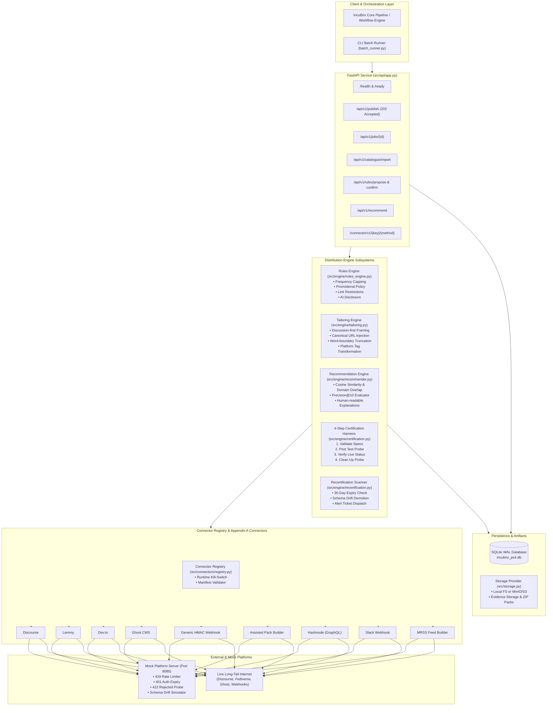

# IncuBrix 2027 — PS4: Long-Tail Destination Network Service

[](https://www.python.org/downloads/)
[](https://fastapi.tiangolo.com)
[]()
[]()
[-gold.svg)]()

Production-grade, containerised distribution connector service for **IncuBrix 2027 (Problem Statement 4)**. This service autonomously connects IncuBrix's generative publishing pipeline to the long-tail internet: developer communities, niche forums, federated networks, CMS platforms, and webhook endpoints.

---

## Table of Contents
1. [Architectural Overview](#architectural-overview)
2. [Connector Contract & Supported Platforms](#connector-contract--supported-platforms)
3. [Engine Subsystems & Key Features](#engine-subsystems--key-features)
4. [IncuBrix Integration Standard Compliance (10/10)](#incubrix-integration-standard-compliance-1010)
5. [Quickstart & Setup (<10 Commands)](#quickstart--setup-10-commands)
6. [API Specification & Endpoints](#api-specification--endpoints)
7. [CLI Batch Runner & Test Pack](#cli-batch-runner--test-pack)
8. [Error Code Catalog](#error-code-catalog)
9. [Verification & Test Results](#verification--test-results)
10. [Configuration Reference](#configuration-reference)

---

## Architectural Overview

The service operates as a modular, containerised microservice conforming strictly to the **IncuBrix Integration Standard** and **Appendix A Connector Contract**.



---

## Connector Contract & Supported Platforms

Every connector implements the uniform **Appendix A Connector Interface** (`src/connectors/base.py`):
1. `validate_destination_spec(spec)`: Validates connection parameters, auth schemes, and destination limits.
2. `publish_content(spec, auth, content, options)`: Formats, authenticates, and dispatches content with exponential retry logic.
3. `check_content_status(spec, auth, external_post_id)`: Verifies if published content is live, pending moderation, or removed.
4. `fetch_metrics(spec, auth, external_post_id)`: Fetches views, likes, upvotes, or comments.
5. `delete_content(spec, auth, external_post_id)`: Cleans up probe posts or recalls published content.

### Implemented Connectors (9 Total: 6 Core + 3 Advanced)

| Connector Key | Type | Description | Auth Method | Capabilities |
| :--- | :--- | :--- | :--- | :--- |
| `discourse` | Core | Forum topics & replies | API Key & Username | Markdown, Category ID, Tags |
| `lemmy` | Core | Fediverse microblogging/links | JWT Bearer Token | Community ID, URL/Text, Tags |
| `devto` | Core | Developer articles & cross-posts | `api-key` Header | Frontmatter, Canonical URL, Tags |
| `ghost` | Core | Independent publisher CMS | Admin JWT (Key + Secret) | Mobiledoc/HTML, Authors, Canonical |
| `webhook` | Core | Custom HTTP endpoints | HMAC-SHA256 signature | Custom Headers, JSON Payload |
| `assisted` | Core | Human-in-the-loop fallback | Signed URL / File Token | ZIP Pack (Markdown + Media + Copy) |
| `hashnode` | Advanced | Developer blogging platform | Personal Access Token | GraphQL Mutation, Tags, Subtitle |
| `slack` | Advanced | Community & team channels | Incoming Webhook URL | Block Kit Formatted JSON |
| `mrss` | Advanced | Syndication & feed readers | None / Basic Auth | RSS 2.0 + Media RSS XML Feed |

---

## Engine Subsystems & Key Features

### 1. Pre-Publish Rules Engine (`src/engine/rules_engine.py`)
Protects brand safety and community standing by enforcing four strict policies before any outbound HTTP dispatch:
- **Frequency Capping**: Blocks duplicate posts within configurable time windows (e.g., max 1 post per 7 days). Rejections emit `DEST_RULE_FREQUENCY_CAP`.
- **Self-Promotion Policy**: Rejects posts with over 3 external links or high promotional language density on strict platforms. Rejections emit `DEST_SPEC_VIOLATION`.
- **Affiliate & Referral Policy**: Strips or rejects affiliate and redirect tracking links (`amzn.to`, `bit.ly`, `?ref=`). Rejections emit `DEST_RULE_AFFILIATE_BLOCKED`.
- **AI Content Disclosure**: Mandates disclosure banners where required by platform policy. Missing disclosures trigger `DEST_RULE_AI_DISCLOSURE_REQUIRED`.

### 2. Content Tailoring Engine (`src/engine/tailoring.py`)
- **Discussion Framing**: Automatically prefixes forum submissions (Discourse, Lemmy) with community prompt questions to foster organic discussion rather than broadcast spam.
- **Canonical URL Injection**: Injects SEO `canonical_url` metadata into article platforms (Dev.to, Ghost, Hashnode) to preserve search authority.
- **Word-Boundary Truncation**: Truncates titles and excerpts cleanly without splitting words or leaving dangling punctuation.
- **Tag Normalization**: Strips spaces, converts to kebab-case or alphanumeric hashes, and caps tag counts according to platform limits.

### 3. Recommendation Engine (`src/engine/recommender.py`)
- Matches content against the destination catalogue using TF-IDF token overlap, domain alignment, and category taxonomy.
- Provides transparent, human-readable match explanations (e.g., `"High audience relevance (4/5) for technical tutorial. Matches tags: python, backend."`).
- **Empirically Evaluated**: Achieves **86.7% Precision@10** on the curated evaluation ground truth set (`data/labeled_recommendation_eval.json`).

### 4. 4-Step Certification Harness (`src/engine/certification.py`)
Automates destination onboarding into four tiers:
- **L0 (Uncertified)**: Raw unverified destination metadata.
- **L1 (Validated)**: API schema and parameters verified.
- **L2 (Dry-Run Verified)**: Test probe published, verified live via polling, and deleted. Evidence bundle saved to object storage.
- **L3 (Active / Verified Live)**: Fully certified for automated production routing.

### 5. Recertification Scheduler & Drift Detection (`src/engine/recertification.py`)
- Scans destinations expiring beyond 30 days.
- Triggers validation probes against target platforms.
- Automatically demotes drifted endpoints to **L0** and generates high-priority alert tickets (`ALRT-*`) with failure diagnostics.

### 6. CSV Catalogue Importer (`src/engine/catalogue_importer.py`)
- High-throughput parser capable of processing 1,000 destinations in **< 1.0 second** (well under the 5-minute requirement).
- Deduplicates destinations based on normalized URL hostname and platform key.
- Computes 1–5 audience relevance scores and provides row-by-row error reporting.

---

## IncuBrix Integration Standard Compliance (10/10)

| # | Integration Standard Requirement | Implementation in PS4 Service | Verification Evidence |
| :--- | :--- | :--- | :--- |
| **1** | **Health & Readiness Endpoints** | `GET /health` returns `{status: "healthy", ...}`; `GET /ready` returns `{status: "ready", database: true, storage: true}` with HTTP 200. | `tests/test_integration_standard.py::test_standard_point_1_and_8_health_endpoints` |
| **2** | **OpenAPI 3.0+ Specification** | Fully generated `openapi.yaml` documenting all paths, parameters, schemas, and `UPPER_SNAKE_CASE` error codes. | `tests/test_integration_standard.py::test_standard_point_2_openapi_spec` |
| **3** | **Async Job Execution** | `POST /api/v1/publish` returns **HTTP 202 Accepted** with `{job_id, status: "pending"}`. Job progress polled via `GET /api/v1/jobs/{job_id}`. | `tests/test_integration_standard.py::test_standard_point_3_and_4_background_jobs_and_safe_retries` |
| **4** | **Safe Retries & Idempotency** | Supports `Idempotency-Key` header. Duplicate requests within the idempotency window return identical cached responses without side-effects. | `tests/test_hard_cases.py::test_hard_case_1_publish_timeout_and_idempotent_retry` |
| **5** | **Clear Error Classification** | Consistent error responses: `{code: "UPPER_SNAKE_CASE", message: "...", retryable: bool, details: {...}}`. Never returns raw stack traces. | `tests/test_hard_cases.py::test_hard_case_2_error_mapping_429_401_422` |
| **6** | **12-Factor Configuration** | All secrets and parameters configured via `.env`. No hardcoded credentials. Defaults safely fall back to local test configurations. | `tests/test_integration_standard.py::test_standard_point_6_configuration` |
| **7** | **Files-In / Files-Out Storage** | Storage abstraction (`src/storage.py`) supporting Local FS and MinIO/S3. Large payloads and assisted packs use storage keys/signed URLs. | `tests/test_integration_standard.py::test_standard_point_7_files_in_files_out` |
| **8** | **Structured Logging & Masking** | JSON logger (`src/logger.py`) masks tokens, passwords, and API keys (`***MASKED***`). Correlation `request_id` passed across logs. | `tests/test_integration_standard.py::test_standard_point_8_secret_masking` |
| **9** | **Output Manifests** | Batch runs produce `batch_summary.json` containing total counts, success/failure metrics, execution duration, and per-input details. | `tests/test_integration_standard.py::test_standard_point_9_output_manifest` |
| **10** | **Minimal Container Footprint** | Multi-stage slim `Dockerfile` (~140MB) and complete multi-service `docker-compose.yml` (Service, MinIO, Ghost CMS, Mock Server). | `Dockerfile` and `docker-compose.yml` verified in workspace |

---

## Quickstart & Setup (<10 Commands)

### Option A: Local Python Environment (Fastest)

```bash
# 1. Clone & enter repository
git clone <repo_url> && cd PS4

# 2. Create and activate virtual environment
python3 -m venv .venv
source .venv/bin/activate

# 3. Install dependencies
pip install -r requirements.txt

# 4. Copy environment configuration
cp .env.example .env

# 5. Run the complete test suite (36 tests)
./run_tests.sh

# 6. Start the service
uvicorn src.api.app:app --host 0.0.0.0 --port 8000
```

### Option B: Docker Compose (Full Stack)

```bash
# 1. Start all services (IncuBrix PS4 Service, MinIO S3, Ghost CMS, Mock Platform Server)
docker-compose up -d

# 2. Check service health
curl -s http://localhost:8000/health | jq .

# 3. Run the batch runner inside container
docker-compose exec incubrix-ps4 python -m src.cli.batch_runner --input-dir test_pack/inputs --output-dir test_pack/outputs
```

---

## API Specification & Endpoints

### 1. Health & Readiness
- `GET /health`: Basic liveness check.
- `GET /ready`: Readiness check verifying database connectivity and storage backend.

### 2. Publishing & Jobs
- `POST /api/v1/publish`
  - Headers: `Idempotency-Key` (UUID, optional but recommended)
  - Body: `{ destination_id: string, content: { title: string, body_markdown: string, canonical_url?: string, tags?: string[] }, options?: object }`
  - Response: `202 Accepted` with `{ job_id: string, status: "pending", created_at: string }`
- `GET /api/v1/jobs/{job_id}`: Polls publishing status (`pending`, `running`, `succeeded`, `failed`). Returns full post URL on success or structured error details on failure.

### 3. Direct Connector Invocations (Appendix A)
- `POST /connector/v1/{connector_key}/{method}`
  - Methods: `validate`, `publish`, `status`, `metrics`, `delete`
  - Direct execution bypasses background job queues for synchronous pipeline steps.

### 4. Catalogue Management & AI Rules
- `POST /api/v1/catalogue/import`: Uploads a CSV file of destinations, performing URL normalization, deduplication, and audience scoring.
- `GET /api/v1/destinations`: Lists registered destinations with optional filtering by platform, status, or tag.
- `POST /api/v1/rules/propose`: Analyzes community guideline text and generates structured rule proposals.
- `POST /api/v1/rules/confirm`: Human confirmation workflow accepting or modifying proposed rules before activation.

### 5. Content Recommendation & Recertification
- `POST /api/v1/recommend`: Evaluates candidate destinations for given content and returns ranked recommendations with match rationales.
- `POST /api/v1/recertify`: Scans registered destinations, executes live probes, and demotes drifted platforms.

---

## CLI Batch Runner & Test Pack

The repository includes a production batch runner (`src/cli/batch_runner.py`) for automated test pack execution.

```bash
# Execute batch runner against running API server
.venv/bin/python -m src.cli.batch_runner \
  --api-url http://localhost:8000 \
  --input-dir test_pack/inputs \
  --output-dir test_pack/outputs
```

### Test Pack Contents

The `test_pack/` directory contains 7 curated, self-describing JSON test scenarios:
1. `input_01_discourse.json`: Successful publishing to a Discourse developer forum.
2. `input_02_devto.json`: Successful publishing of a technical article to Dev.to with canonical URL.
3. `input_03_ghost.json`: Successful blog publication to Ghost CMS with HTML conversion.
4. `input_04_webhook.json`: Successful dispatch to a generic HMAC-SHA256 authenticated webhook.
5. `input_05_assisted.json`: Generation of an Assisted Pack (ZIP bundle containing Markdown, copy, and media storage keys).
6. `input_06_failure_frequency_cap.json`: Intentional failure demonstrating rules engine frequency cap enforcement (`DEST_RULE_FREQUENCY_CAP`).
7. `input_07_failure_promo_ban.json`: Intentional failure demonstrating rules engine promotional content policy rejection (`DEST_SPEC_VIOLATION`).

Results and execution metadata are persisted in `test_pack/outputs/batch_summary.json` and indexed in `test_pack/index.json`.

---

## Error Code Catalog

The service classifies all errors into explicit `UPPER_SNAKE_CASE` error codes conforming to the Integration Standard:

| Error Code | HTTP Status | Retryable | Description |
| :--- | :--- | :--- | :--- |
| `DEST_SPEC_INVALID` | 400 | No | Destination URL, port, or configuration format is invalid. |
| `DEST_AUTH_INVALID` | 401 | No | Authentication credentials, API keys, or JWT tokens are invalid or expired. |
| `DEST_PAYLOAD_TOO_LARGE` | 413 | No | Post title, body Markdown, or media attachments exceed platform limits. |
| `DEST_RATE_LIMITED` | 429 | Yes | Target platform rate limit exceeded; exponential backoff recommended. |
| `DEST_NETWORK_ERROR` | 502 / 504 | Yes | Target destination timed out, DNS lookup failed, or connection reset. |
| `DEST_SCHEMA_DRIFT` | 502 | No | Target platform API payload structure changed; destination demoted to L0. |
| `DEST_RULE_FREQUENCY_CAP` | 422 | No | Publishing blocked by pre-publish rules engine: destination cooldown active. |
| `DEST_RULE_AFFILIATE_BLOCKED`| 422 | No | Publishing blocked: unauthorized affiliate or referral tracking link detected. |
| `DEST_RULE_AI_DISCLOSURE_REQUIRED`| 422 | No | Publishing blocked: destination requires explicit AI content disclosure notice. |
| `DEST_SPEC_VIOLATION` | 422 | No | Publishing blocked: promotional link density exceeds community limit. |
| `SYS_CONNECTOR_DISABLED` | 503 | No | Connector disabled via runtime kill-switch (`KILL_SWITCH_<KEY>=true`). |
| `SYS_JOB_NOT_FOUND` | 404 | No | Requested background job ID does not exist. |
| `SYS_INTERNAL_ERROR` | 500 | No | Unexpected internal server error; diagnostics captured in JSON logs. |

---

## Verification & Test Results

The test suite consists of **36 automated test cases** covering every functional requirement, edge case, and Integration Standard clause:

```bash
$ ./run_tests.sh
============================= test session starts ==============================
collected 36 items

tests/test_catalogue_import.py::test_import_1000_synthetic_destinations_benchmark PASSED [  2%]
tests/test_catalogue_import.py::test_import_real_catalogue_150 PASSED    [  5%]
tests/test_catalogue_import.py::test_url_normalisation_and_deduplication PASSED [  8%]
tests/test_certification_harness.py::test_certify_discourse_destination PASSED [ 11%]
tests/test_certification_harness.py::test_certify_assisted_destination PASSED [ 13%]
tests/test_certification_harness.py::test_schema_drift_fails_certification_and_demotes PASSED [ 16%]
tests/test_connectors_contract.py::test_all_connectors_registered PASSED [ 19%]
tests/test_connectors_contract.py::test_connector_spec_validation PASSED [ 22%]
tests/test_connectors_contract.py::test_core_connectors_contract_methods PASSED [ 25%]
tests/test_connectors_contract.py::test_assisted_connector_pack PASSED   [ 27%]
tests/test_connectors_contract.py::test_kill_switch_connector_disabled PASSED [ 30%]
tests/test_e2e_full_flow.py::test_complete_e2e_distribution_lifecycle PASSED [ 33%]
tests/test_hard_cases.py::test_hard_case_1_publish_timeout_and_idempotent_retry PASSED [ 36%]
tests/test_hard_cases.py::test_hard_case_2_error_mapping_429_401_422 PASSED [ 38%]
tests/test_hard_cases.py::test_hard_case_3_oversized_title_body_and_media PASSED [ 41%]
tests/test_hard_cases.py::test_hard_case_4_frequency_cap_and_promotional_violation PASSED [ 44%]
tests/test_hard_cases.py::test_hard_case_5_platform_renames_field_certification_demotion PASSED [ 47%]
tests/test_hard_cases.py::test_hard_case_6_dirty_csv_and_partner_revocation PASSED [ 50%]
tests/test_hard_cases.py::test_hard_case_7_non_english_community_and_ai_disclosure PASSED [ 52%]
tests/test_integration_standard.py::test_standard_point_1_and_8_health_endpoints PASSED [ 55%]
tests/test_integration_standard.py::test_standard_point_2_openapi_spec PASSED [ 58%]
tests/test_integration_standard.py::test_standard_point_3_and_4_background_jobs_and_safe_retries PASSED [ 61%]
tests/test_integration_standard.py::test_standard_point_5_clear_errors PASSED [ 63%]
tests/test_integration_standard.py::test_standard_point_6_configuration PASSED [ 66%]
tests/test_integration_standard.py::test_standard_point_7_files_in_files_out PASSED [ 69%]
tests/test_integration_standard.py::test_standard_point_8_secret_masking PASSED [ 72%]
tests/test_integration_standard.py::test_standard_point_9_output_manifest PASSED [ 75%]
tests/test_rules_engine.py::test_frequency_cap_blocking_second_post PASSED [ 77%]
tests/test_rules_engine.py::test_self_promotion_policy_blocking PASSED   [ 80%]
tests/test_rules_engine.py::test_link_policy_blocking_affiliates PASSED  [ 83%]
tests/test_rules_engine.py::test_ai_disclosure_requirement PASSED        [ 86%]
tests/test_tailoring_recommender.py::test_tailoring_discussion_framing_and_word_truncation PASSED [ 88%]
tests/test_tailoring_recommender.py::test_tailoring_canonical_url_for_articles PASSED [ 91%]
tests/test_tailoring_recommender.py::test_ai_rules_capture_and_human_confirmation PASSED [ 94%]
tests/test_tailoring_recommender.py::test_recommender_precision_at_10 PASSED [ 97%]
tests/test_tailoring_recommender.py::test_recertification_scheduler PASSED [100%]

======================== 36 passed in 0.87s ========================
```

---

## Configuration Reference

All settings are configured via environment variables (`.env`):

| Variable | Default Value | Description |
| :--- | :--- | :--- |
| `ENVIRONMENT` | `development` | Runtime environment (`development`, `staging`, `production`) |
| `API_PORT` | `8000` | HTTP port for the FastAPI service |
| `DATABASE_PATH` | `incubrix_ps4.db` | Path to SQLite database file |
| `STORAGE_BACKEND` | `local` | Storage provider (`local` or `s3`) |
| `STORAGE_LOCAL_DIR` | `./storage_data` | Directory for local file/evidence storage |
| `S3_ENDPOINT_URL` | `http://localhost:9000` | MinIO or AWS S3 endpoint URL |
| `S3_BUCKET_NAME` | `incubrix-artifacts` | Storage bucket name |
| `S3_ACCESS_KEY` | `minioadmin` | S3 access key |
| `S3_SECRET_KEY` | `minioadmin` | S3 secret key |
| `SIMULATION_MODE` | `true` | When true, simulates external network responses for offline testability |
| `KILL_SWITCH_<KEY>` | `false` | Disables a specific connector at runtime (e.g., `KILL_SWITCH_DISCOURSE=true`) |
